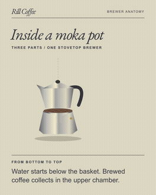
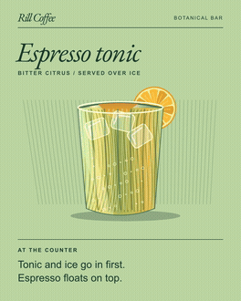
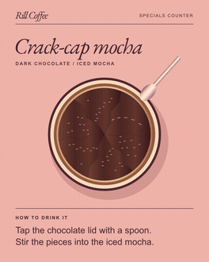

# Doro Creator Toolkit

**Make static and animated carousels for your business.** Start with a question your customers already ask. Tell your agent the answer, and it builds a set of slides you can open in the studio, edit in your own brand and share. Creation and downloads are free.

> [!IMPORTANT]
> **Schedule your finished image carousel with DoroSocial.** Tell your connected agent where and when you want to post. Review the slides, caption, accounts and times together. Once you approve, your agent can schedule the posts across supported accounts or publish them now. You only need a Doro connection when you choose to send. [DoroSocial](https://doro.social)

## Make your first carousel

Open an agent that can work on your computer, such as Codex or Claude Code. Fill in the two brackets and paste this message. A question you answered for a customer this week is a good place to start.

```text
Use https://github.com/Doro-Social/doro-creator-toolkit and set it up for me.
I run [your business]. My customers often ask “[their question]”.
Ask me how I usually answer, then turn my answer into a short carousel.
Finish with one practical step my customers can take. Use animation if it helps
explain the idea, and give me the studio link so I can review the slides.
```

The included **Carousel Creator skill** gives your agent the instructions to set up the toolkit, build the slides, check how they fit and prepare the files. On the first run, your agent may ask permission to install software. Your part is to bring the idea and decide when the draft is ready.

## Pick a template for the job

The library includes **four editable starter carousels**. Each uses a fictional café to demonstrate a different way to structure a post. Pick the structure you like and ask your agent to build it around your business. Here’s how the same templates could work in other industries.

| Starting point | What you could make with it |
| --- | --- |
| Answer a common question | A wedding photographer compares six and eight hours of coverage using two sample timelines. |
| Announce something new | A fitness coach introduces a beginner class and walks people through their first session. |
| Compare products or services | A software company shows which of its three plans fits a freelancer, a small team or an agency. |
| Tell your business story | A real estate agent takes sellers behind the scenes of their first open house. |

## See three animation styles in action

These clips feature **Rill Coffee, a fictional business used for the demos**. Watch how each style explains something visually. An exploded view can show how a product fits together. A frame break can draw the eye to one detail. Open a tile to watch the full clip, or explore all **21 looping examples** in the studio.

| Exploded View | Liquid Glass | Frame Break |
| :---: | :---: | :---: |
| [](public/motion-studies/exploded-view.mp4) | [](public/motion-studies/liquid-glass.mp4) | [](public/motion-studies/frame-break.mp4) |

## Make it yours in the studio

Open the preview link and flip through the draft as your customer would. If slide three makes the best opening, drag it to the front. Drop in a photo from your latest shoot, class or product launch, add your logo, and save your colors as a brand kit for next time. Save logos, icons, screenshots and photos to a separate library for each business. Next time, just tell your agent which brand the post is for. Six slide layouts include comparisons, checklists and product spotlights.

**Choose where motion earns its place.** In the editor, use **Snap Zoom** to draw attention to a detail, **Headline Storm** to bring a short heading together, or **Checklist Pop** to reveal steps in order. Gentle Rise, Soft Fade and Still round out the six choices. The gallery films above are custom examples for inspiration. The editor treatments work with your own words and artwork.

**Get the right file for each channel.** Download ordered images for a swipeable post, individual animated clips alongside your still slides, or one full video. For LinkedIn, export a PDF with one complete slide per page. You can also draft a different caption for each destination.

## Prompts to try on your own business

**Turn a customer question into a post**
> People keep asking which of my two services they should book. I’ll give you the differences. Make a comparison carousel and end with a question that helps them choose.

**Give people a reason to save it**
> Turn my home-tour notes into a checklist for first-time buyers. Use one photo per room where I’ve supplied one. Reveal the three questions to ask the agent on the last slide.

**Get two posts from one draft**
> Use my approved slides to make a square image carousel for Instagram and a portrait PDF for LinkedIn. Keep the original, and write a caption for each audience.

## Next time you have an idea

Ask your agent to reopen Doro Creator Toolkit on the same computer. Your saved projects and brand kits are there to use again. Once the studio is running, you can also start with a template and edit it yourself.

<details>
<summary>Optional setup and technical details</summary>

The agent-led workflow has been tested on macOS. First-time setup requires internet access. Your agent needs local file and software access and may have its own subscription requirements. The toolkit stores projects and exports on your computer.

[Manual setup guide](docs/technical-guide.md) · [Carousel Creator skill](skills/carousel-creator/SKILL.md) · [Project architecture](docs/architecture.md) · [License](LICENSE)

</details>
